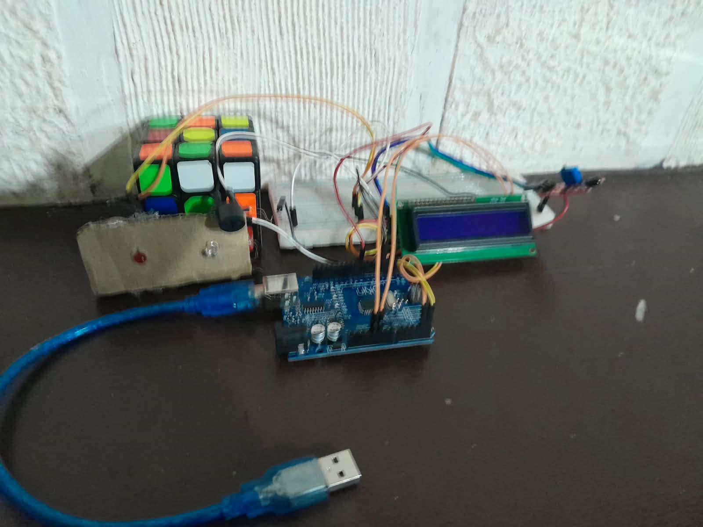

# Smart-Flame-Detection-System

# Smart Flame Detection & Early Warning System

An Arduino-based safety device featuring real-time flame detection, buzzer alerts, visual LED indicators, and an I2C LCD status display.

## Hardware Components
- Arduino Uno SMD R3
- Flame Sensor (KY-026)
- Active Buzzer
- 16x2 LCD Display with I2C

## Bill of Materials (BOM)
A detailed BOM with component links and prices is included in this repository as `bom.csv`.

## Project Images / Working Photos
.jpg)
.jpg)

.jpg)
